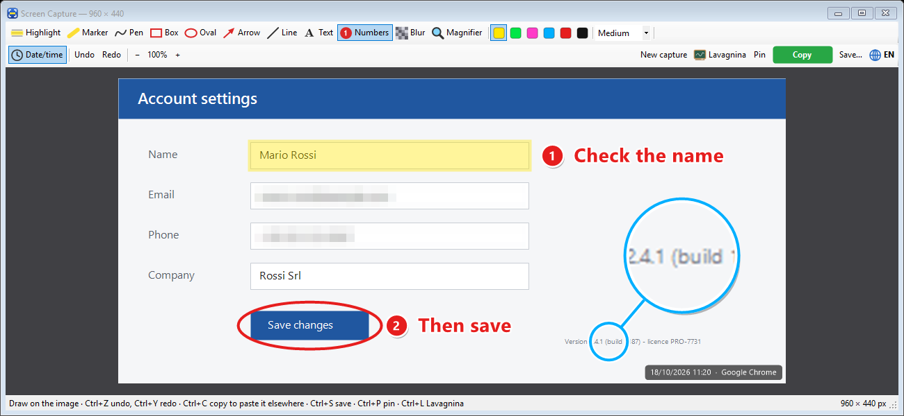

# Cattura Schermo (Screen Capture)

[🇮🇹 Italiano](README.md) · 🇬🇧 English

A **Windows 10/11** tool that captures the screen (or part of it) with a keyboard shortcut,
lets you **highlight, number, write on and blur** whatever you need, and then **copy the image**
to paste it anywhere, or save it.

> The interface is available in **Italian and English** (IT/EN button).



## How it started

I'm not a programmer: I'm a consultant who helps small businesses use artificial intelligence.
I take a lot of screenshots to explain procedures to clients and colleagues and for my training slides,
and I wanted a tool that does exactly what I need, quickly. So I described what I wanted and built it with
**Claude Code**, adding one feature at a time while using it.
The AI wrote the code; I defined what I needed, tested and corrected the result.

The same approach works for the small operational annoyances of any business.
→ [marcofedeli.com](https://marcofedeli.com)

## What it does

**Capture**
- **Ctrl+Alt+S**: the screen dims and you drag to choose the area. A single click takes the whole monitor, `Esc` cancels.
- **Ctrl+Alt+F**: immediately captures the full screen the mouse is on.
- Works with multiple monitors and with display scaling (125%, 150%…).


**Annotation tools**

| Tool | Key | What it does |
|---|---|---|
| Highlight | `1` | Transparent yellow rectangle over an area |
| Marker | `2` | Freehand highlighter (`Shift` = straight line) |
| Pen | `3` | Freehand drawing |
| Box | `4` | Empty rectangle: move, resize and rotate it (`Shift` = square) |
| Oval | `O` | Circle or oval: move, resize and rotate it (`Shift` = circle) |
| Arrow | `5` | Arrow |
| Line | `0` | Straight line (`Shift` = horizontal, vertical or 45°) |
| Text | `6` | Text with an outline that reads on any background: move, tilt and resize it |
| Numbers | `7` | Circles 1, 2, 3… that number themselves, with a box for the description beside them |
| Blur | `8` | Pixelates names, emails, numbers and other sensitive data (the original stays out of the image) |
| Magnifier | `9` | Circle that magnifies a detail; when moved it stays linked to the original spot, and the magnified spot can be dragged elsewhere too |

- 6 colours and 3 thicknesses (**Thin / Medium / Thick**, which are the sizes for text).
- **Undo / Redo** (`Ctrl+Z` / `Ctrl+Y`), including moves, rotations and resizes.
- **Zoom** with `Ctrl` + mouse wheel.
- An automatic label at the bottom right with **date, time and the captured program**
  (e.g. "18/10/2026 11:20 · Google Chrome"), removed with one click on **Date/time**.

**Then**
- **Automatic copy**: as soon as you capture, the image is already on the clipboard, as if you had pressed `Ctrl+C`: paste right away with `Ctrl+V`. Turn it off from the tray menu (**Copy to clipboard right away**).
- **Copy** (`Ctrl+C`, the green button): the image goes to the clipboard, ready to paste with `Ctrl+V` into Word, email, WhatsApp, Teams…
  The button briefly shows **✔ Copied**. With the Windows clipboard history (`Win+V`) you can keep several captures and paste the one you want.
- **Save** (`Ctrl+S`): PNG, JPG or BMP.
- **Lavagnina** (`Ctrl+L`): if you also have Lavagnina (a freehand whiteboard) on your PC, a button sends the image, with your marks, to the open whiteboard.
- **Pin** (`Ctrl+P`): the image stays **on screen, always on top**, with a border in the chosen colour,
  while you work in another window. Drag it to move it, the wheel changes its size,
  `Ctrl` + wheel its transparency, double-click closes it.

**In general**
- **Italian and English** interface: **IT/EN** button in the toolbar or **Lingua / Language** in the tray menu.
- Optional **Start with Windows** from the tray menu.
- Nothing to install, no dependencies: a single `.exe` of about 90 KB.

## Download

Download `CatturaSchermo.exe` from the [**Releases**](../../releases) page and double-click it.
An icon appears next to the clock (if you don't see it, look among the hidden icons under the **^** arrow).

> **Note:** the program is not digitally signed, so Windows may show
> "Windows protected your PC". Click **More info → Run anyway**.
> If you prefer, you can build it yourself from the source code (see below).

## How to use it

| Where | What you do |
|---|---|
| `Ctrl+Alt+S` or click on the icon | Choose the area to capture |
| `Ctrl+Alt+F` | Capture the full screen |
| In the editing window | Pick a tool and draw; `Ctrl+C` copies, `Ctrl+S` saves, `Ctrl+P` pins |
| With Text, Box or Oval active | Hover over an existing shape: drag it to move it, the dot to rotate it, the small squares to resize it |
| Right-click on the icon | Menu: capture, copy right away, start with Windows, language, exit |

## Building from source

Nothing to install: it uses the C# compiler already included in Windows (.NET Framework 4.x).

```powershell
powershell -ExecutionPolicy Bypass -File build.ps1
```

It creates `CatturaSchermo.exe` (and its icon) in the same folder. If the program is running, the script closes it first.

## Where it stores data

Captures only end up where you copy or save them: the program keeps no archive.
The chosen language is in `HKEY_CURRENT_USER\Software\CatturaSchermo`. With **Start with Windows** on there is also a
`CatturaSchermo` entry in `HKEY_CURRENT_USER\Software\Microsoft\Windows\CurrentVersion\Run`.

**Uninstall:** untick **Start with Windows**, choose **Exit**, delete the `.exe` and, if you like,
the key above.

## License

[MIT](LICENSE)
