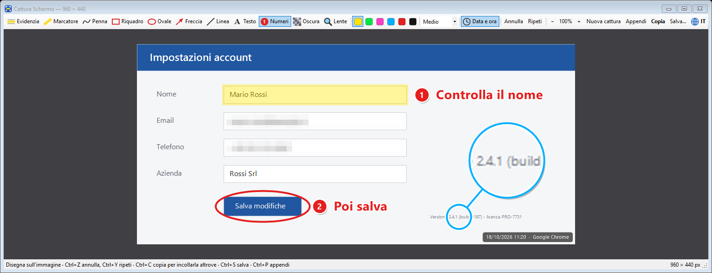
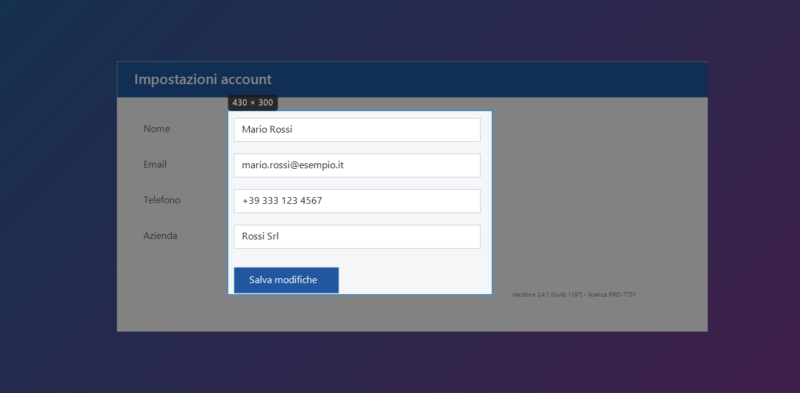

# Cattura Schermo

🇮🇹 Italiano · [🇬🇧 English](README.en.md)

Un programma per **Windows 10/11** che cattura lo schermo (o una parte) con una combinazione di tasti,
ti permette di **evidenziare, numerare, scrivere e oscurare** quello che serve e poi **copiare l'immagine**
per incollarla dove vuoi, oppure salvarla.



## Come è nato

Non sono un programmatore: sono un consulente che aiuta le PMI a usare l'intelligenza artificiale.
Faccio molti screenshot per spiegare procedure a clienti e colleghi e per le slide dei corsi, e volevo
uno strumento che facesse esattamente quello che mi serve, in fretta. Così ho descritto cosa volevo e
l'ho costruito con **Claude Code**, aggiungendo una cosa alla volta mentre lo usavo.
Il codice l'ha scritto l'AI; io ho definito cosa mi serviva, provato e corretto il risultato.

Lo stesso metodo funziona per i piccoli fastidi operativi di un'azienda.
→ [marcofedeli.com](https://marcofedeli.com)

## Cosa fa

**Cattura**
- **Ctrl+Alt+S**: lo schermo si scurisce e trascini per scegliere l'area. Un clic semplice prende tutto il monitor, `Esc` annulla.
- **Ctrl+Alt+F**: cattura subito lo schermo intero su cui c'è il mouse.
- Funziona con più monitor e con lo schermo ingrandito (125%, 150%…).



**Strumenti per segnare l'immagine**

| Strumento | Tasto | Cosa fa |
|---|---|---|
| Evidenzia | `1` | Rettangolo giallo trasparente sopra un'area |
| Marcatore | `2` | Evidenziatore a mano libera (`Maiusc` = linea dritta) |
| Penna | `3` | Disegno a mano libera |
| Riquadro | `4` | Rettangolo vuoto: si sposta, si ridimensiona e si ruota (`Maiusc` = quadrato) |
| Ovale | `O` | Cerchio o ovale: si sposta, si ridimensiona e si ruota (`Maiusc` = cerchio) |
| Freccia | `5` | Freccia |
| Linea | `0` | Linea dritta (`Maiusc` = orizzontale, verticale o 45°) |
| Testo | `6` | Testo con bordo leggibile su ogni sfondo: si sposta, si inclina e si ridimensiona |
| Numeri | `7` | Cerchietti 1, 2, 3… che si numerano da soli, con la casella per la descrizione accanto |
| Oscura | `8` | Pixela nomi, email, numeri e altri dati sensibili (il dato originale non resta nell'immagine) |
| Lente | `9` | Cerchio che ingrandisce un dettaglio; spostandolo resta collegato al punto d'origine |

- 6 colori e 3 spessori (**Sottile / Medio / Spesso**, che per il testo sono le dimensioni).
- **Annulla / Ripeti** (`Ctrl+Z` / `Ctrl+Y`) anche per spostamenti, rotazioni e ridimensionamenti.
- **Zoom** con `Ctrl` + rotellina.
- In basso a destra una scritta automatica con **data, ora e programma catturato**
  (es. "18/10/2026 11:20 · Google Chrome"), che si toglie con un clic su **Data e ora**.

**Dopo**
- **Copia** (`Ctrl+C`): l'immagine va negli appunti, pronta da incollare con `Ctrl+V` in Word, email, WhatsApp, Teams…
- **Salva** (`Ctrl+S`): PNG, JPG o BMP.
- **Appendi** (`Ctrl+P`): l'immagine resta **sullo schermo, sempre in primo piano**, con un bordo del colore scelto,
  mentre lavori in un'altra finestra. Si sposta trascinandola, la rotellina cambia la grandezza,
  `Ctrl` + rotellina la trasparenza, doppio clic la chiude.

**In generale**
- Interfaccia in **italiano e inglese**: pulsante **IT/EN** nella barra o voce **Lingua / Language** nel menu dell'icona.
- **Avvia con Windows**, se vuoi, dal menu dell'icona.
- Nessuna installazione e nessuna dipendenza: un solo file `.exe` di circa 90 KB.

## Download

Scarica `CatturaSchermo.exe` dalla pagina [**Releases**](../../releases) e avvialo con un doppio clic.
Compare un'icona vicino all'orologio (se non la vedi, guarda tra le icone nascoste, sotto la freccia **^**).

> **Nota:** il programma non ha una firma digitale, quindi Windows potrebbe mostrare
> "Windows ha protetto il PC". Clicca **Ulteriori informazioni → Esegui comunque**.
> Se preferisci, puoi compilarlo tu dal codice sorgente (vedi sotto).

## Come si usa

| Dove | Cosa fai |
|---|---|
| `Ctrl+Alt+S` o clic sull'icona | Scegli l'area da catturare |
| `Ctrl+Alt+F` | Catturi lo schermo intero |
| Nella finestra di modifica | Scegli uno strumento e disegna; `Ctrl+C` copia, `Ctrl+S` salva, `Ctrl+P` appende |
| Con Testo, Riquadro o Ovale attivo | Passa sopra una forma già messa: trascinala per spostarla, il pallino per ruotarla, i quadratini per ridimensionarla |
| Clic destro sull'icona | Menu: cattura, avvio con Windows, lingua, esci |

## Compilare dal codice sorgente

Non serve installare niente: si usa il compilatore C# già incluso in Windows (.NET Framework 4.x).

```powershell
powershell -ExecutionPolicy Bypass -File build.ps1
```

Crea `CatturaSchermo.exe` (e la sua icona) nella stessa cartella. Se il programma è aperto, lo script lo chiude prima.

## Dove salva i dati

Le catture restano solo dove le copi o le salvi tu: il programma non tiene nessun archivio.
La lingua scelta è in `HKEY_CURRENT_USER\Software\CatturaSchermo`. Con **Avvia con Windows** attivo c'è anche la voce
`CatturaSchermo` in `HKEY_CURRENT_USER\Software\Microsoft\Windows\CurrentVersion\Run`.

**Disinstallare:** togli la spunta a **Avvia con Windows**, scegli **Esci**, elimina l'`.exe` e, se vuoi,
la chiave qui sopra.

## Licenza

[MIT](LICENSE)
